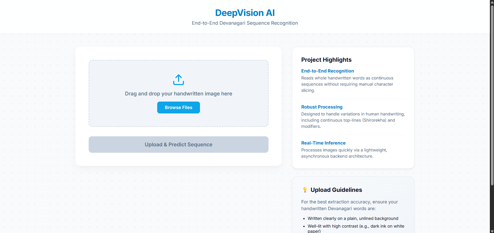
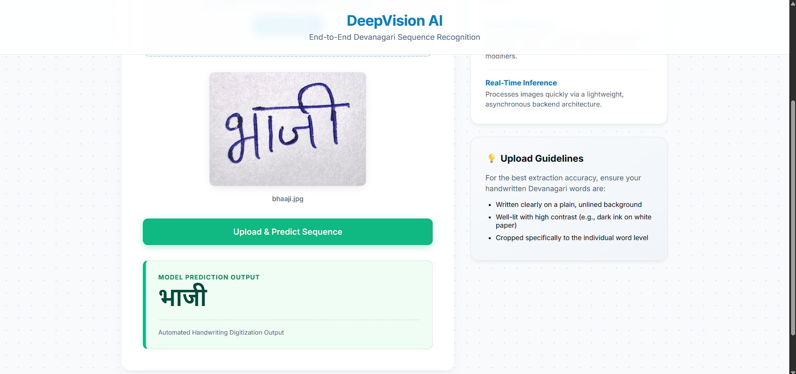
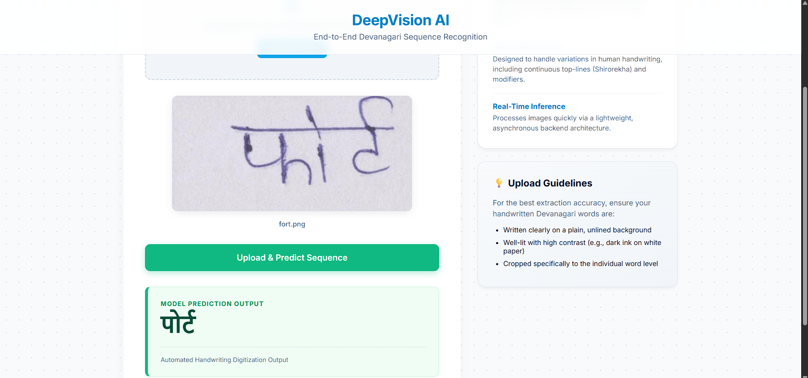

# DeepVision AI — Handwritten Devanagari Word Recognition

> An end-to-end deep learning system that reads handwritten Hindi words from images and transcribes them into digital Devanagari text, using a hybrid CNN + Transformer architecture trained with CTC Loss.

---

## Table of Contents

1. [Project Overview](#project-overview)
2. [Problem Statement](#problem-statement)
3. [Project Objectives](#project-objectives)
4. [Key Features](#key-features)
5. [Technologies and Libraries Used](#technologies-and-libraries-used)
6. [Project Architecture and Folder Structure](#project-architecture-and-folder-structure)
7. [System Workflow](#system-workflow)
8. [Algorithms and Machine Learning Concepts](#algorithms-and-machine-learning-concepts)
9. [Dataset Information](#dataset-information)
10. [Installation and Setup](#installation-and-setup)
11. [How to Run the Project](#how-to-run-the-project)
12. [Usage Instructions](#usage-instructions)
13. [Screenshots](#screenshots)
14. [Model Training and Prediction Workflow](#model-training-and-prediction-workflow)
15. [Evaluation Metrics](#evaluation-metrics)
16. [Limitations](#limitations)
17. [Future Improvements](#future-improvements)
18. [Contributors](#contributors)

---

## Project Overview

**DeepVision AI** is a Handwritten Text Recognition (HTR) system built for the Hindi language (Devanagari script). It takes an image of a single handwritten Hindi word as input and outputs the digitized Unicode text — no manual character segmentation needed.

The core idea is to treat handwriting recognition as a **sequence labelling problem**: instead of identifying characters one by one (which requires knowing where each character starts and ends), the model reads the entire word image left-to-right and produces a character sequence all at once. This is made possible by the **Connectionist Temporal Classification (CTC)** framework.

A clean web interface (HTML/CSS/JS) allows users to upload or drag-and-drop an image, which is then sent to a **FastAPI** backend for real-time inference.

---

## Problem Statement

Devanagari handwriting recognition is significantly harder than Latin script recognition due to the script's structural complexity:

- **Shirorekha (top-line)**: Characters in a word share a continuous horizontal bar at the top, making clean character segmentation nearly impossible without deep understanding of the script.
- **Conjunct consonants (ligatures)**: Two or more consonants fuse into a single glyph when written together.
- **Dependent vowel markers (matras)**: Vowels are attached as modifiers above, below, left, or right of consonants, changing their appearance entirely.
- **Large character set**: Over 100 unique Unicode code points are needed to represent all characters, modifiers, and punctuation in standard written Hindi.

Conventional OCR systems designed for segmentation-first pipelines fail on Devanagari because clean character-level segmentation is not achievable before recognition. This project addresses that gap with a segmentation-free, end-to-end approach.

---

## Project Objectives

- Build an end-to-end HTR model that recognises entire handwritten Hindi words without manual segmentation.
- Train the model on a large-scale, publicly available real handwriting dataset.
- Deploy the model as a REST API (FastAPI) for real-time inference.
- Provide a clean, beginner-friendly web UI for demonstration.
- Evaluate the model using standard HTR metrics: Character Error Rate (CER) and Word Error Rate (WER).

---

## Key Features

| Feature | Details |
|---|---|
| **End-to-end recognition** | Reads whole words without needing to locate individual characters |
| **Hybrid architecture** | Combines ResNet-18 (CNN) with a Transformer Encoder for spatial + sequential understanding |
| **CTC decoding** | Greedy CTC decoder handles repeated characters and blank tokens correctly |
| **109-class vocabulary** | Covers the full Devanagari Unicode block: vowels, consonants, matras, digits, and punctuation |
| **FastAPI backend** | Asynchronous REST API accepts Base64-encoded images and returns predicted text |
| **Drag-and-drop Web UI** | Responsive HTML/CSS/JS frontend with live preview and smooth UX |
| **GPU/CPU flexible** | Automatically uses CUDA if available, falls back to CPU gracefully |

---

## Technologies and Libraries Used

### Backend / ML Stack

| Library | Version | Purpose |
|---|---|---|
| `torch` (PyTorch) | ≥ 2.0 | Model definition, training loop, inference |
| `timm` | ≥ 0.9 | Pre-trained ResNet-18 backbone (ImageNet weights) |
| `torchvision` | ≥ 0.15 | Image transforms and normalization pipeline |
| `fastapi` | ≥ 0.100 | Asynchronous REST API server |
| `uvicorn` | ≥ 0.22 | ASGI server to serve the FastAPI app |
| `Pillow` (PIL) | ≥ 9.0 | Image loading and preprocessing |
| `datasets` (HuggingFace) | ≥ 2.0 | Downloading and streaming the training dataset |
| `editdistance` | ≥ 0.6 | Computing Levenshtein distance for CER/WER metrics |
| `pydantic` | ≥ 2.0 | Request body validation in FastAPI |
| `numpy` | ≥ 1.24 | Numerical operations |
| `matplotlib` | ≥ 3.7 | Loss convergence plotting during training |

### Frontend Stack

| Technology | Purpose |
|---|---|
| HTML5 | Page structure and file input |
| CSS3 (custom) | Responsive layout, animations, component styling |
| Vanilla JavaScript (ES6+) | Drag-and-drop, FileReader API, Fetch API for async requests |
| Google Fonts (Inter) | Typography |

---

## Project Architecture and Folder Structure

```
Words_final/
│
├── main.py                    # FastAPI server — loads model, defines /predict_sentence endpoint
├── hybrid_ctc_model.pth       # Trained model weights (~27 MB)
├── ctc_vocab.json             # Index-to-character mapping for the CTC decoder (109 classes)
├── requirements.txt           # Python dependency requirements
├── .gitignore                 # Git ignore rules for cache, venv, and checkpoints
│
├── index.html                 # Web UI — drag-and-drop upload interface
├── style.css                  # UI styling — layout, animations, responsive design
├── script.js                  # Frontend logic — file handling, API requests, result display
│
├── TrainingScript_0.ipynb     # Initial training experiment (vocabulary building + first training run)
├── TrainingScript_1.ipynb     # Final training script with checkpointing, early stopping, loss plotting
├── Testing.ipynb              # Evaluation notebook — CER, WER, Word Accuracy on test split
│
├── screenshots/               # Application UI and evaluation screenshots
│   ├── upload_ui.png          # Web interface upload area
│   ├── prediction_result.png  # Successful prediction output
│   ├── Failed.png             # Failed / misclassified sample output
│   └── loss_convergence_graph.png # Loss convergence over epochs
│
└── Testing_Images/            # Sample handwritten word images for manual testing
    ├── *.jpg / *.png          # Real handwriting samples used during development
    └── temp/                  # Smaller, cleaner reference samples
```

**Files that must be present to run the application:**

- `main.py` — the server
- `hybrid_ctc_model.pth` — trained weights
- `ctc_vocab.json` — vocabulary map
- `index.html`, `style.css`, `script.js` — the UI

---

## System Workflow

Here is the complete flow from uploading an image to seeing the recognised text:

```
User uploads image (JPG/PNG)
        │
        ▼
Browser reads file → converts to Base64 string (FileReader API)
        │
        ▼
JavaScript sends POST request to http://localhost:8000/predict_sentence
  Body: { "image": "data:image/png;base64,..." }
        │
        ▼
FastAPI endpoint (/predict_sentence) receives the request
        │
        ▼
Base64 string is decoded → PIL Image (RGB, any resolution)
        │
        ▼
Image is resized to 64 × 384 pixels
  (height=64 is the fixed row height; width=384 covers word width)
        │
        ▼
Normalize with ImageNet mean/std → PyTorch tensor [1, 3, 64, 384]
        │
        ▼
CNN (ResNet-18 layers 1–3) extracts spatial feature maps → [1, 256, 4, 24]
        │
        ▼
Sequence builder Conv2d (4×1 kernel) collapses height → [1, 256, 1, 24]
  Reshaped to 24 time steps: [1, 24, 256]
        │
        ▼
Transformer Encoder (2 layers, 8 attention heads) captures context → [1, 24, 256]
        │
        ▼
Fully connected layer projects to 109 classes → [24, 1, 109]
  Log-softmax gives probability distributions
        │
        ▼
Greedy CTC Decoder:
  - Pick argmax at each of the 24 time steps
  - Remove consecutive duplicate predictions
  - Remove <BLANK> tokens (index 0)
        │
        ▼
Map remaining indices → Devanagari characters via ctc_vocab.json
        │
        ▼
Return JSON: { "status": "success", "prediction": "शिकार" }
        │
        ▼
Browser displays the predicted text in the result box
```

---

## Algorithms and Machine Learning Concepts

### 1. Connectionist Temporal Classification (CTC)

CTC is a training objective specifically designed for sequence tasks where the alignment between input and output is unknown. In handwriting recognition, we know what a word says, but we don't know which part of the image corresponds to which character.

**How it works:**
- The model outputs a probability distribution over all characters (including a special `<BLANK>`) at each of the 24 time steps.
- CTC sums over all possible alignments (ways to collapse the output sequence into the target text) using dynamic programming.
- During inference, a greedy decoder picks the most likely character at each step, then:
  1. Removes consecutive duplicates (e.g., `ककक` → `क`)
  2. Removes all `<BLANK>` tokens

This allows the model to predict variable-length words even though the output is always 24 steps long.

### 2. Hybrid CNN + Transformer Architecture (`HybridCTCModel`)

The model has three distinct stages:

**Stage 1 — Feature Extraction (ResNet-18 CNN):**
- Layers used: `conv1`, `bn1`, `act1`, `maxpool`, `layer1`, `layer2`, `layer3`
- Input `[B, 3, 64, 384]` → Output `[B, 256, 4, 24]`
- ResNet was pre-trained on ImageNet, which means it already knows how to detect edges, curves, and shapes — extremely useful for handwriting.

**Stage 2 — Sequence Construction:**
- A single `Conv2d(256, 256, kernel_size=(4, 1))` collapses the 4-pixel-tall feature map into 1 row.
- Result is reshaped to `[B, 24, 256]`: 24 feature vectors, each representing a "time step" (a column of the word image).

**Stage 3 — Contextual Understanding (Transformer Encoder):**
- 2 Transformer Encoder layers with 8 attention heads.
- Each of the 24 time steps can attend to all other time steps, capturing long-range dependencies (e.g., understanding a matra by its relationship to the consonant it modifies).
- Output: `[B, 24, 256]`

**Final Classification:**
- A linear layer maps 256 dimensions → 109 classes.
- Log-softmax gives log-probabilities, which are what `nn.CTCLoss` expects.

### 3. CTC Loss

```python
criterion = nn.CTCLoss(blank=0, zero_infinity=True)
```

- `blank=0` — index 0 in the vocabulary is the `<BLANK>` token.
- `zero_infinity=True` — prevents training crashes from rare, numerically unstable batches (common with long or complex words).
- The loss receives: model predictions `[T, B, C]`, target label sequences, input lengths, and target lengths.

### 4. Training Details

| Hyperparameter | Value |
|---|---|
| Optimizer | Adam |
| Learning Rate | 0.0003 |
| Batch Size | 32 |
| Epochs | 15 |
| Gradient Clipping | max_norm = 2.0 |
| Sequence Length (T) | 24 time steps |

Gradient clipping (`clip_grad_norm_`) is used to prevent gradient explosions — a common problem when training with CTC loss on complex scripts.

### 5. Greedy CTC Decoder

```python
def decode_predictions(predictions):
    predicted_text = []
    previous_char_idx = -1
    for idx in predictions:
        idx = idx.item()
        if idx != 0 and idx != previous_char_idx:
            predicted_text.append(idx_to_char[idx])
        previous_char_idx = idx
    return "".join(predicted_text)
```

This implements the two core CTC decoding rules in a single pass over the 24 time steps.

---

## Dataset Information

**Dataset:** [IIIT-INDIC-HW-WORDS-Hindi](https://huggingface.co/datasets/c3rl/IIIT-INDIC-HW-WORDS-Hindi)
**Source:** Hugging Face Datasets Hub (`c3rl/IIIT-INDIC-HW-WORDS-Hindi`)
**Language:** Hindi (Devanagari script)
**Domain:** Real handwritten word images

| Split | Samples |
|---|---|
| Train | Used for model training |
| Validation | Used for monitoring overfitting |
| Test | 12,869 samples used for final evaluation |

Each sample contains:
- A grayscale/color image of a single handwritten Hindi word
- The corresponding Unicode ground-truth text label

The vocabulary was built **dynamically** from the training split — all unique Unicode characters found in training labels were collected, sorted, and indexed starting from 1 (index 0 is reserved for `<BLANK>`). This produced a vocabulary of **109 classes**.

---

## Installation and Setup

### Prerequisites

- Python 3.9 or higher
- `pip` package manager
- A CUDA-compatible GPU (optional but strongly recommended for real-time inference; CPU works too)

### Step 1: Clone the repository

```bash
git clone https://github.com/your-username/DeepVision_Words.git
cd DeepVision_Words
```

### Step 2: Create and activate a virtual environment

```bash
# Create virtual environment
python -m venv venv

# Activate on Windows
venv\Scripts\activate

# Activate on macOS/Linux
source venv/bin/activate
```

### Step 3: Install dependencies

```bash
pip install -r requirements.txt
```

> **GPU users (CUDA 11.8):** Install PyTorch with GPU support first, then install the rest:
> ```bash
> pip install torch torchvision --index-url https://download.pytorch.org/whl/cu118
> pip install -r requirements.txt
> ```

> **CPU-only users:** The default `requirements.txt` installs the CPU version of PyTorch automatically — no extra steps needed.

---

## How to Run the Project

### Start the FastAPI backend server

```bash
uvicorn main:app --host 0.0.0.0 --port 8000
```

You should see output like:

```
Loading CTC vocabulary...
Successfully loaded 109 classes.
Model weights loaded successfully.
INFO:     Uvicorn running on http://0.0.0.0:8000
```

### Open the Web UI

Open `index.html` directly in your browser (double-click the file or use a local server like VS Code Live Server).

The UI connects to `http://localhost:8000` by default. If your backend is on a different port, update the URL in `script.js` (line 75).

---

## Usage Instructions

1. **Start the backend** using the `uvicorn` command above.
2. **Open `index.html`** in a web browser.
3. **Upload a handwritten Hindi word image:**
   - Click the upload area and browse for a file, **or**
   - Drag and drop a `.jpg`, `.jpeg`, or `.png` image directly onto the dashed box.
4. **Click "Upload & Predict Sequence".**
5. The predicted Devanagari text will appear in the green result box below the button.

**Tips for best results:**
- Crop the image tightly to the word (no large margins).
- Use high contrast (dark ink on a white/light background).
- Avoid ruled lines behind the text.
- Write on a plain, unlined sheet of paper.

### Testing with the included sample images

The `Testing_Images/` folder contains sample real handwritten Hindi words that were used during development. You can upload any of these directly to test the system:

```
Testing_Images/
├── namaste.jpeg      ← "नमस्ते"
├── guru.jpeg         ← "गुरु"
├── shanti.jpeg       ← "शांति"
├── dharma.jpeg       ← "धर्म"
├── gyaan.jpeg        ← "ज्ञान"
...
```

---

## Screenshots

**1. Web Interface — Upload Area**



**2. Successful Prediction Result**



**3. Failed / Misclassified Prediction**



**4. Training Loss Convergence Graph**


---

## Model Training and Prediction Workflow

The training pipeline is split across two Jupyter notebooks designed to run on **Google Colab (T4 GPU)**:

### `TrainingScript_0.ipynb` — Initial Experiment

This notebook sets up the full pipeline for the first time:
1. Installs dependencies (`datasets`, `timm`, `torch`, etc.)
2. Downloads the IIIT-INDIC-HW-WORDS-Hindi dataset from Hugging Face.
3. Dynamically builds the character vocabulary from all training labels.
4. Saves `ctc_vocab.json` immediately (so the vocabulary is preserved even if training is interrupted).
5. Defines `HFWordDataset` (a PyTorch `Dataset` wrapper around the HuggingFace dataset).
6. Defines the `ctc_collate_fn` (a custom collation function that pads target sequences for a batch, since words have different lengths).
7. Defines and trains the first version of `HybridCTCModel`.
8. Saves weights to `hybrid_ctc_model.pth`.

### `TrainingScript_1.ipynb` — Final Training Run

This is the production training notebook with improvements:
1. All the same setup as Script 0.
2. **Metric tracking:** `history_train_loss` and `history_val_loss` are recorded every epoch.
3. **Checkpoint saving every epoch:** Saves `hybrid_ctc_model_checkpoint.pth` with model state, optimizer state, and loss history — allows resuming from any epoch.
4. **Interrupt handling:** `try/except KeyboardInterrupt` catches manual stops and saves an emergency checkpoint.
5. **Loss plotting:** After training, generates and saves `loss_convergence_graph.png` using Matplotlib.
6. **Final model save:** Saves the clean `hybrid_ctc_model.pth` (weights only) for deployment.

### `Testing.ipynb` — Model Evaluation

Evaluates the trained model on the official test split:
1. Loads `ctc_vocab.json` and `hybrid_ctc_model.pth`.
2. Runs inference on all 12,869 test samples.
3. Computes **Character Error Rate (CER)** and **Word Error Rate (WER)** using the `editdistance` library (Levenshtein distance).
4. Prints a sample of correctly and incorrectly predicted words for qualitative inspection.

---

## Evaluation Metrics

The model was evaluated on the official **test split** (12,869 words) of the IIIT-INDIC-HW-WORDS-Hindi dataset:

| Metric | Value |
|---|---|
| Total Test Words Evaluated | 12,869 |
| **Character Error Rate (CER)** | **15.73%** |
| **Word Error Rate (WER)** | **53.27%** |
| **Overall Word Accuracy** | **46.73%** |

**What these numbers mean:**
- **CER of 15.73%** means that on average, about 1 in 6–7 characters in the output is wrong (inserted, deleted, or substituted). The majority of characters are predicted correctly.
- **Word Accuracy of 46.73%** means the model predicts the entire word exactly correctly roughly half the time. This is a strict metric — a single wrong character anywhere in the word counts the entire word as wrong.
- Devanagari's complexity (conjunct consonants, stacked matras) makes exact word-level matches significantly harder than character-level accuracy would suggest.

**Sample successful predictions:**

| Ground Truth | Predicted | Result |
|---|---|---|
| शिकार | शिकार | ✅ Match |
| प्रवेश | प्रवेश | ✅ Match |
| परिष्कृत | परिष्कृत | ✅ Match |
| मेकर्स | मेकर्स | ✅ Match |
| अनाथों | अनाथों | ✅ Match |

---

## Limitations

- **Single-word input only:** The model is designed and trained on individual, isolated words. It cannot read multi-word lines, sentences, or paragraphs.
- **Fixed input resolution:** Images are forcibly resized to 64×384 pixels. Very short words (1–2 characters) lose spatial resolution; very long words (more than ~10 characters) can be cramped.
- **Greedy decoding:** Only the simplest CTC decoding strategy is used. Beam-search decoding (with or without a language model) would significantly improve WER.
- **No language model integration:** Predictions are made purely from visual features with no linguistic prior. Common word corrections or spelling-aware decoding are not applied.
- **Vocabulary coverage:** Only characters that appeared in the training dataset are in the vocabulary. Rare or archaic Devanagari characters not in the training data cannot be predicted.
- **Image quality sensitivity:** Very low contrast images, heavily cursive or personal handwriting styles, and images with complex backgrounds can degrade predictions.

---

## Future Improvements

- [ ] **Beam-search CTC decoder** with a language model (KenLM) to significantly reduce WER.
- [ ] **Line-level recognition:** Extend the pipeline to handle full lines of text using a line segmentation module upstream.
- [ ] **Data augmentation:** Add random rotations, perspective transforms, elastic distortions, and brightness jitter during training for better generalisation.
- [ ] **Deeper backbone:** Replace ResNet-18 with ResNet-34/50 or a Vision Transformer (ViT) for stronger feature extraction.
- [ ] **Attention-based decoder:** Replace CTC with a sequence-to-sequence model with cross-attention, which can better model long-range character dependencies.
- [ ] **Batch inference:** Add batch prediction support to the API for bulk image processing.
- [ ] **Containerisation:** Wrap the backend in a Docker container for easy deployment.
- [ ] **Model quantisation:** Apply INT8 quantisation to `hybrid_ctc_model.pth` to reduce model size and improve CPU inference speed.

---

## Contributors

| Name | Role |
|---|---|
| **Khush** | Model architecture, training pipeline, and core system design |
| **Dhruvi Nanotkar** | Web UI, testing, and FastAPI backend |

---

## Acknowledgements

- **Dataset:** [IIIT-INDIC-HW-WORDS-Hindi](https://huggingface.co/datasets/c3rl/IIIT-INDIC-HW-WORDS-Hindi) — provided by the Center for Computational Research in Linguistics (CCRL).
- **ResNet-18 backbone:** Pre-trained weights from ImageNet via the [`timm`](https://github.com/huggingface/pytorch-image-models) library by Ross Wightman.
- **CTC Framework:** [A. Graves et al., "Connectionist Temporal Classification: Labelling Unsegmented Sequence Data with Recurrent Neural Networks," ICML 2006.](https://dl.acm.org/doi/10.1145/1143844.1143891)

---

*B.Tech Engineering · Pattern Recognition Minor Project · Computer Vision & Deep Learning*
